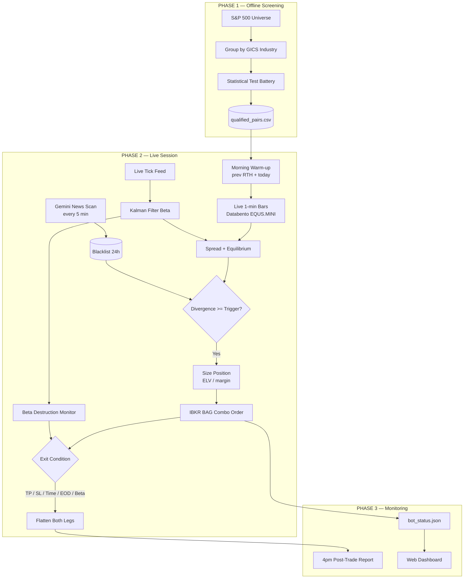

# 📈 S&P 500 Pairs Trading Bot — Statistical Arbitrage Engine

<div align="center">


**A market-neutral intraday statistical arbitrage bot that screens the S&P 500 for cointegrated pairs, then trades mean reversion of their price spread through Interactive Brokers.**

*Cointegration-verified pairs. Kalman-filtered hedge ratios. Guaranteed combo execution. No martingale, no averaging down, no overnight risk.*

</div>

---

## 📖 Table of Contents

- [Overview](#overview)
- [Architecture](#architecture)
- [Strategy Logic](#strategy-logic)
- [Daily Schedule](#daily-schedule)
- [Phase 1 — Pair Screening](#phase-1--pair-screening)
- [Phase 2 — Live Execution Engine](#phase-2--live-execution-engine)
- [Phase 3 — Dashboard](#phase-3--dashboard)
- [Risk Management](#risk-management)
- [Configuration](#configuration)
- [Installation](#installation)
- [Deployment](#deployment)
- [Testing](#testing)
- [FAQ](#faq)
- [License](#license)

---

## Overview

This bot trades **the spread between two statistically related stocks**, not the stocks themselves. When two cointegrated companies in the same industry temporarily drift apart, it shorts the relatively expensive one and buys the relatively cheap one, then closes both legs when the spread reverts to its equilibrium.

Because both legs are held simultaneously in opposite directions, the position is **market-neutral** — a broad market move affects both legs and largely cancels out. The bot is only exposed to the *relationship* between the two stocks.

Three independent stages:

1. **Phase 1 — Screening.** Scans the S&P 500 for pairs that survive a battery of statistical tests. Runs offline, produces a qualified pair list.
2. **Phase 2 — Execution.** Monitors those pairs live, decides when to enter and exit, and places the orders.
3. **Phase 3 — Dashboard.** A web view of live state, plus a manual symbol blacklist.

---

## Architecture



---

## Strategy Logic

### The Spread

```
Spread_t = P_A,t − β · P_B,t
```

Where **β** is the hedge ratio — how many shares of B offset one share of A. The **Equilibrium Spread** is the rolling 60-minute mean of that spread, and everything is measured relative to it.

> ⚠️ Correlation is used **only** in Phase 1 to qualify a pair. The bot trades deviations of the **spread**, never deviations of the correlation.

### Entry

```
1. A divergence event opens — |Spread − Equilibrium| leaves the ~zero band and widens
2. Compare against the historical Mean of Maximum Divergence
   (mean peak of past events that reverted to equilibrium within 2 hours,
    recalculated continuously over previous RTH + today)
3. ✅ ENTER when ALL of:
      • |divergence| ≥ historical mean of maximum divergence
      • |divergence| ≥ $0.30
      • Neither leg on the news blacklist
      • Time is between 10:00 and 15:30 ET
      • Today is not an early-close day
      • No prior losing trade today (kill-switch)
4. Direction:
      Spread ABOVE equilibrium → SELL leg A, BUY leg B
      Spread BELOW equilibrium → BUY leg A, SELL leg B
5. If several pairs qualify at once, take the highest
   Adjusted Spread Efficiency = (|divergence| / price_A × 100) / half-life
```

### Exit

Checked every cycle, in strict priority order:

| # | Exit | Condition |
|---|---|---|
| 1 | 🌙 **EOD** | 15:59 ET — overrides everything |
| 2 | 🟢 **Take Profit** | Spread returns to equilibrium (within tolerance) |
| 3 | ⏱️ **Max Holding Time** | `(2 × half-life) + 20 minutes` elapsed |
| 4 | 🔴 **Stop Loss** | Unrealized loss ≥ 2% of the 09:25 ET equity snapshot |
| 5 | 💥 **Beta Destruction** | Hedge relationship statistically invalidated (below) |

### Beta Destruction Stop Loss

A separate, tick-level safety net that fires when the *statistical relationship itself* breaks down, rather than when the trade simply loses money. **All five conditions must hold simultaneously:**

| Condition | Threshold |
|---|---|
| Relative beta drift from entry | ≥ 10% |
| Absolute beta drift | ≥ 0.08 |
| Unrealized loss | ≥ 0.05% of entry equity |
| Live Pearson correlation | ≤ 0.88 |
| Live ADF p-value | > 0.05 (spread no longer stationary) |

Plus a **confirmation window** to filter out momentary order-book sweeps: the breakdown must hold for **5 consecutive ticks AND 3 full seconds**. If prices snap back before that, the counter resets and the trade stays open.

On confirmation: cancel working orders → flatten both legs at market → blacklist that pair for 24 hours.

---

## Daily Schedule

All times **Eastern**. The bot sleeps between steps and wakes itself.

| Time | Action |
|---|---|
| `08:25` | `reqTradingHours()` — confirm today's session; abort entirely if early close |
| `09:25` | Gemini pre-market news scan → blacklist · **equity snapshot for stop loss** |
| `09:29` | **Equity snapshot for position sizing** |
| `09:30` | Warm-up from previous RTH + today, live feeds start, monitoring begins |
| `10:00` | Entry window **opens** |
| `09:30–15:30` | Intraday news re-scan every 5 minutes (non-blocking) |
| `15:30` | Entry window **closes** — no new positions |
| `15:59` | Hard flatten — all positions closed unconditionally |
| `16:00` | Post-trade report emailed |

> 💡 Two separate equity snapshots are deliberate: **09:25** fixes the day's risk budget, **09:29** fixes position size. They serve different purposes and are not interchangeable.

---

## Phase 1 — Pair Screening

Groups the S&P 500 by GICS industry and tests every within-industry pair against the full battery. A pair must pass **every** test:

| Test | Requirement | Why |
|---|---|---|
| Same industry | Required | Shared macro drivers |
| Pearson correlation | ≥ 0.90 | Moves together |
| Engle-Granger ADF | p < 0.05 | Spread is stationary |
| Johansen test | Confirmed | Independent cointegration check |
| Half-life | < 60 minutes | Reverts fast enough to trade intraday |
| Hurst exponent | < 0.5 | Mean-reverting, not trending |
| Spread volatility | Stable | Relationship isn't decaying |
| ADV **or** dollar volume | > 10M shares **or** > $1B/day | Liquid enough to exit |
| Market cap | > $20B | Both legs are large caps |

```bash
python3 phase1/screen_pairs.py                    # Databento (production)
python3 phase1/screen_pairs.py --source yfinance  # free fallback, no API key
```

Outputs `data/qualified_pairs.csv` + `.json`.

**Data source note.** Production screening queries the **primary listing exchanges** directly (`XNAS.ITCH` for Nasdaq, `XNYS.PILLAR` for NYSE) rather than a consolidated feed — a consolidated feed measurably changed results during validation. Dividend adjustment is applied from yfinance, since this account's Databento datasets carry no corporate-actions schema.

| File | Role |
|---|---|
| `sp500_universe.py` | Ticker list with GICS sector/industry |
| `databento_source.py` | Production price fetch + dividend adjustment |
| `data_source.py` | yfinance fallback + market cap |
| `screening.py` | The statistical test pipeline |
| `screen_pairs.py` | Entry point — builds pairs, runs tests, writes output |

---

## Phase 2 — Live Execution Engine

```bash
python3 phase2/main.py
```

| File | Role |
|---|---|
| `main.py` | Session orchestrator — schedule, monitoring loop, wiring |
| `spread_engine.py` | Spread, equilibrium, divergence-event detection (pure) |
| `kalman_beta.py` | Kalman filter for the live hedge ratio |
| `risk_manager.py` | Entry/exit state machine, beta destruction monitor |
| `position_sizing.py` | Quantity formula + whole-number combo leg ratios |
| `ibkr_client.py` | ibapi wrapper — combo orders, margin probes, flatten |
| `live_data.py` | Databento live bars + ticks, morning warm-up fetch |
| `news_blacklist.py` | Gemini news scan + self-purging 24h blacklist |
| `post_trade_report.py` | Builds and emails the daily report |

### Hedge Ratio — Kalman Filter

β is **not** a fixed daily number. A Kalman filter updates it continuously from live tick data, so the hedge adapts to intraday structural shifts.

Critically, β at **entry is locked** and never moves for that position. All P&L, take-profit, and stop-loss maths for an open trade are measured against the ratio the position was *actually executed at* — otherwise a drifting β would show up as phantom profit and loss the position never experienced.

### Position Sizing

```
units       = floor( (EquityWithLoanValue × 0.98) / (buy margin + sell margin) )
qty_A       = units × ratio_A
qty_B       = units × ratio_B
```

`ratio_A : ratio_B` is β approximated as a reduced **whole-number** ratio (e.g. β = 2.4478 → 93:38). IBKR combo legs only accept integer ratios, which is why **fractional shares are disabled**.

### Order Execution — Guaranteed Combos

Both legs are submitted as a **single IBKR BAG combo order** so they fill together rather than leaving the bot one-legged.

> ⚠️ MKT+MKT combos are **not** Guaranteed by default and IBKR rejects them outright (error 10043) unless explicitly routed non-guaranteed. This is handled — see `combo_market_order()`.

### News Filter

Gemini with **Google Search grounding** answers a live news query at 09:25 and then every 5 minutes during the session. Any symbol with a **Positive or Negative** catalyst is excluded for 24 hours — a news-driven move is real fundamental divergence, not mean-reverting noise, and the bot should not stand in front of it.

Structured output requires two calls: grounding and JSON schema can't be combined in a single Gemini request. Scans run as a background task so a slow response never stalls the trading loop.

---

## Phase 3 — Dashboard

```bash
python3 -m phase3.dashboard      # binds 0.0.0.0:5000
```

Live equity, open positions with unrealized P&L, daily realized P&L, kill-switch state, a plain-English activity feed, and a manual box to block any symbol for 24 hours. Includes a **STOP BOT** control that flattens and ends the session.

Reads `data/bot_status.json`, which the trading loop rewrites every cycle, with a staleness TTL so a dead bot shows as offline rather than freezing on its last known state.

> 🔓 **No authentication.** Anyone with the URL can edit the blacklist or stop the bot. Deliberate — deploy behind a firewall or VPN if that isn't acceptable.

---

## Risk Management

| Control | Behaviour |
|---|---|
| 🛑 **Daily loss kill-switch** | Any position closing at a loss ends **all** trading for the rest of the day |
| 🌙 **No overnight risk** | Everything flat by 15:59 ET, unconditionally |
| ⚖️ **Market neutral** | Long and short legs held simultaneously |
| 💵 **Fixed daily risk budget** | Stop loss is 2% of the 09:25 equity snapshot — it does not grow as the account does |
| 📰 **News exclusion** | Directional catalysts removed for 24h |
| 💥 **Relationship monitoring** | Beta destruction exits when cointegration breaks, not just when P&L does |
| 🚫 **No early-close trading** | Half-days skipped entirely |
| 🔒 **Dry-run by default** | Orders only reach the broker with `IBKR_LIVE_TRADING_ENABLED=1` |

---

## Configuration

`.env` in the project root:

```bash
# Market data
DATABENTO_API_KEY=db-xxxxxxxx

# News filter
GEMINI_API_KEY=xxxxxxxx

# Interactive Brokers
IBKR_HOST=127.0.0.1
IBKR_PORT=4010              # 4001 live / 4002 paper (Gateway), 7496 / 7497 (TWS)
IBKR_CLIENT_ID=99
IBKR_ACCOUNT=DU1234567
IBKR_LIVE_TRADING_ENABLED=0 # 1 to actually submit orders

# Post-trade report
RESEND_API_KEY=re_xxxxxxxx
RESEND_FROM=reports@yourdomain.com
```

| Env var | Purpose |
|---|---|
| `IBKR_LIVE_TRADING_ENABLED` | `0` logs orders without sending them. Controls submission only — **paper vs live is determined by the account/port**, not this flag |
| `PAIRS_BOT_SKIP_TIME_GATES` | `1` skips the scheduled waits for testing. The entry window and EOD flatten still follow the real clock |

---

## Installation

```bash
git clone <repository-url>
cd sp500-pairs-bot

python3 -m venv venv
source venv/bin/activate
pip install -r requirements.txt
```

Create a `.env` with the keys above, then run screening once to produce the pair list and start the engine:

```bash
python3 phase1/screen_pairs.py
python3 phase2/main.py
```

---

## Deployment

Runs headless on a Linux VPS with IB Gateway under Xvfb, started each weekday by cron.

```bash
sudo cp deploy/pairs-bot.service /etc/systemd/system/
sudo systemctl daemon-reload
sudo systemctl enable pairs-bot

# 12:15 UTC = 08:15 ET, weekdays
crontab -e
15 12 * * 1-5 systemctl start pairs-bot
```

The unit deliberately sets `Restart=no` — the bot runs **one session per day** and exits cleanly after the report. Auto-restart would immediately begin a second session.

> 💡 IB Gateway needs a running X display. Use Xvfb plus IBC for unattended login, and verify the API port with `netstat -tlnp | grep java` rather than trusting the config file.

---

## Testing

```bash
pytest tests
```

**550 tests passing**, run entirely against deterministic and synthetic fixtures — no live IBKR, Databento, or Gemini network calls needed during testing.

Coverage includes hand-verified divergence events, P&L identity checks against the two legs' real dollar moves, beta-drift immunity, combo ratio arithmetic, blacklist TTL expiry, and the exit priority ordering.

---

## FAQ

**Q: Is this market neutral?**
A: Largely. Both legs are held in opposite directions, so index-wide moves mostly cancel. The residual exposure is the *relationship* between the two stocks — which is exactly what the beta destruction stop loss watches.

**Q: Why so few qualified pairs?**
A: The screen is deliberately strict — all eight tests must pass, including a $20B market-cap floor and a hard liquidity bar. It is normal for only a handful of S&P 500 pairs to survive. Loosening the thresholds in `phase1/screening.py` widens the universe at the cost of pair quality.

**Q: Why Kalman instead of rolling OLS?**
A: A rolling window weights every observation in it equally and lurches when old data falls out. A Kalman filter updates incrementally per tick and adapts smoothly to structural shifts. The filter here is implemented directly rather than via PyKalman, which is effectively unmaintained.

**Q: What happens if the morning warm-up data fails?**
A: The pair keeps running and rebuilds its statistics from live bars as they accumulate. It simply can't trade until enough history exists to compute a valid equilibrium and trigger level — roughly the first hour.

**Q: Can two pairs be open at once?**
A: Yes. At most one new entry per cycle, but positions on different pairs can coexist. Each exits independently — closing one does not disturb the other.

**Q: Does it average down or martingale?**
A: No. One position per pair, fixed size at entry, no adding to losers.

---

## License

Copyright © 2026. All rights reserved.

This source is published with the owner's permission as a portfolio sample of work by
[Team NAK](https://teamnak.com). No license to use, copy, modify or distribute it is granted.

---

<div align="center">

**S&P 500 Pairs Trading Bot** — intraday statistical arbitrage on Interactive Brokers.

*Trading involves substantial risk of loss. Validate on a paper account before committing capital.*

</div>
